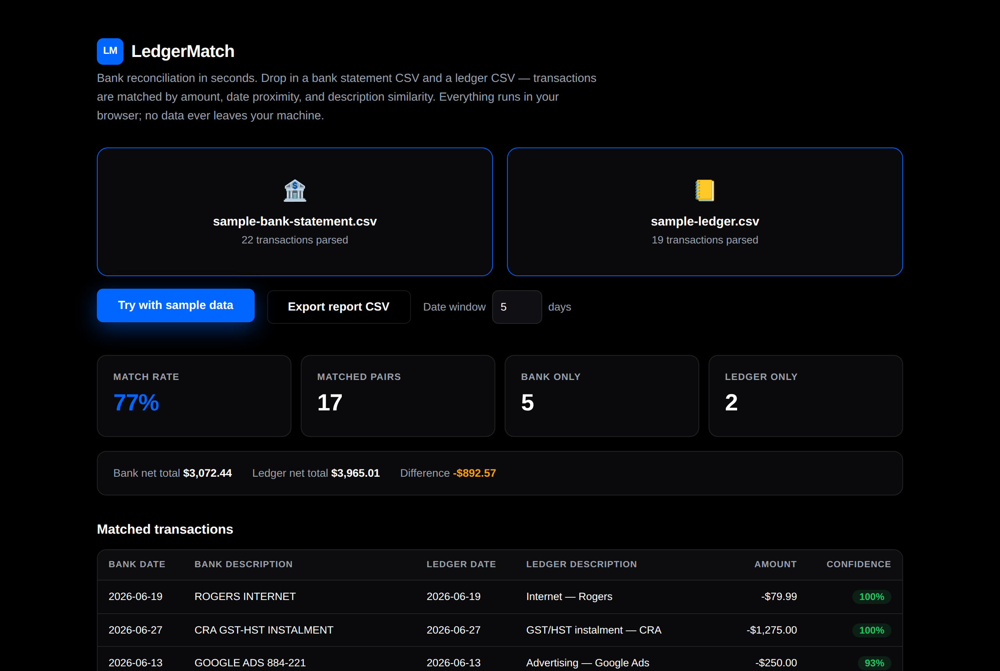

# LedgerMatch — Bank Reconciliation in Seconds

Drop in a **bank statement CSV** and a **ledger CSV** and LedgerMatch reconciles them instantly: transactions are matched by exact amount, date proximity, and description similarity, discrepancies are flagged in both directions, and the whole thing exports as a clean reconciliation report.

**[Live demo →](https://noahbulbring.github.io/ledgermatch/)** — click *"Try with sample data"* to see it work without uploading anything.



## Why

Month-end bank reconciliation is one of the most repetitive jobs in bookkeeping: two lists of the same money, written down differently. `PAYROLL DEPOSIT ACME CORP` on the statement is `Payroll — Acme Corp contract` in the books, posted a day later. LedgerMatch automates the line-by-line comparison so you only look at the exceptions.

## Features

- **Fuzzy matching engine** — exact-amount candidates are scored by date proximity (configurable window) and token-overlap description similarity, then paired greedily best-score-first, so each transaction matches at most once
- **Confidence scores** — every matched pair shows how sure the engine is (green / amber / red)
- **Exception reports** — separate lists for *"on the bank statement, not in your books"* (bank fees, interest) and *"in your books, not on the bank statement"* (outstanding deposits, uncleared cheques)
- **Column auto-detection** — finds date / description / amount (or debit / credit) columns from your CSV headers; handles `$1,234.56`, negatives, and `(bracketed)` accounting negatives
- **CSV report export** — one click produces a reconciliation report you can file with your working papers
- **100% client-side** — plain HTML/CSS/JS, zero dependencies, no upload; your financial data never leaves the browser

## Run locally

```bash
git clone https://github.com/NoahBulbring/ledgermatch.git
cd ledgermatch
open index.html
```

Run the engine tests with Node:

```bash
node test.js
```

## How the matching works

1. Parse both CSVs (RFC-4180-style parser: quotes, escaped quotes, CRLF) and normalize each row to `{date, description, amount}`
2. Index ledger entries by amount; for each bank transaction, score every same-amount ledger candidate:
   - `0.5` for the exact amount match
   - up to `0.3` for date proximity within the window
   - up to `0.2` for Jaccard similarity of description tokens
3. Sort all candidate pairs by score and accept greedily — each bank line and ledger line is used at most once
4. Whatever's left on either side is an exception for human review

## Build prompt

This project was built end-to-end by an AI agent from this prompt:

> Build a bank reconciliation tool: drop in a bank statement CSV and a ledger CSV, fuzzy-match transactions by amount/date/description, flag unmatched items and produce a reconciliation summary. Runs fully client-side.

## License

MIT © Noah Bulbring
